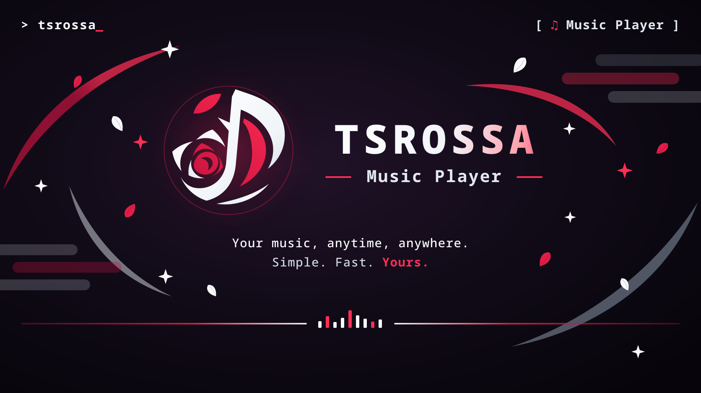
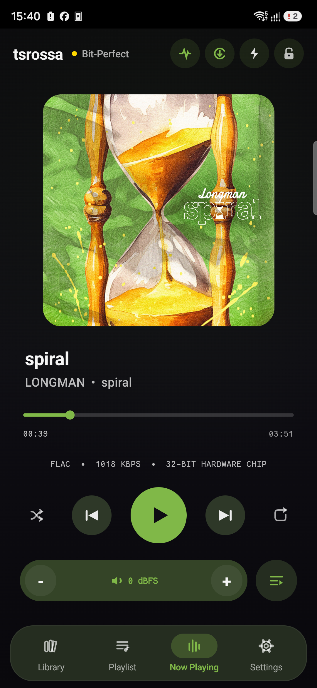
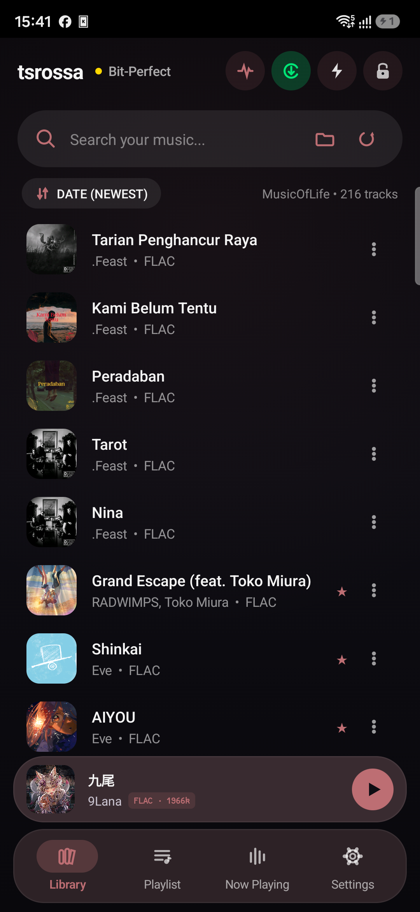
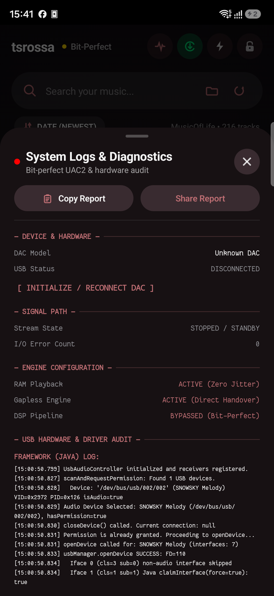
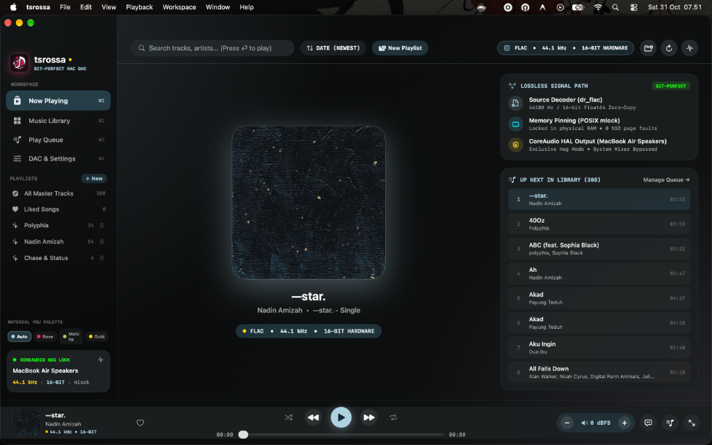
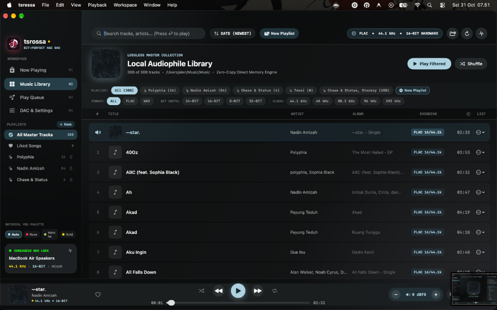
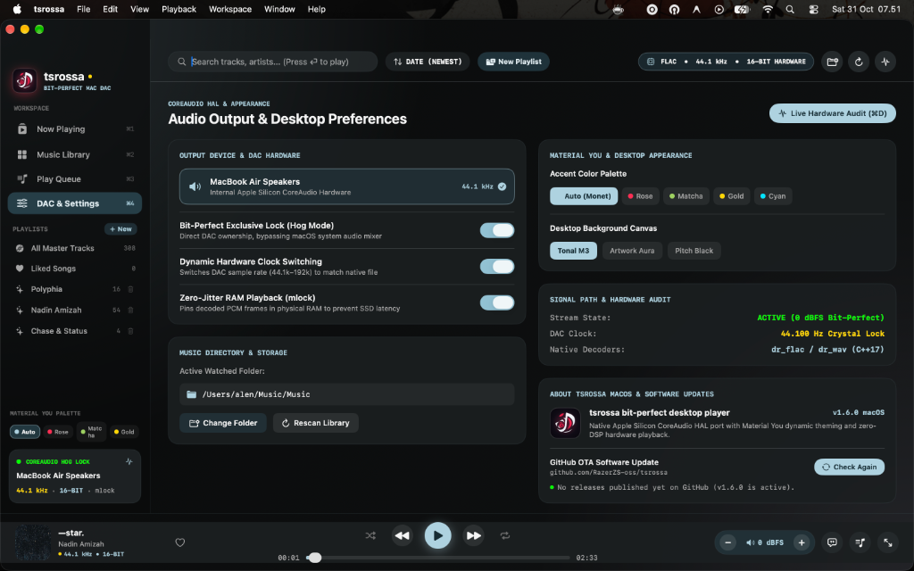

<p align="center">
  
</p>

<h1 align="center">tsrossa</h1>

<p align="center">
  <strong>Direct-to-DAC Bit-Perfect Audio Player for Android & macOS</strong><br/>
  High-fidelity C++ audio engine bypassing Android AudioFlinger and macOS CoreAudio mixer.
</p>

<p align="center">
  <a href="https://github.com/yukaatsu/tsrossa/releases"></a>
  <a href="#"></a>
  <a href="#"></a>
  <a href="#"></a>
  <a href="#"></a>
  <a href="LICENSE"></a>
  <a href="https://bagibagi.co/Yukaatsu"></a>
</p>

---

## Overview

**tsrossa** is an open-source, bit-perfect music player developed specifically for audiophile USB DAC setups on Android and high-end desktop DAC setups on macOS.

Standard operating system audio architectures route playback through software mixing layers:
- **Android** forces playback through `AudioTrack` and `AudioFlinger`, applying mandatory 48 kHz sample-rate conversion (SRC), digital volume truncation, and OS buffer jitter.
- **macOS** passes playback through the system CoreAudio mixer, multiplexing alert sounds and running software resamplers that alter bit-perfect fidelity.

tsrossa bypasses both operating system audio stacks entirely:
- On **Android**, the native C++17 engine uses `libusb-1.0` and raw Linux `usbfs` handles to stream linear PCM directly to external DACs over asynchronous Isochronous endpoints.
- On **macOS**, the engine talks directly to hardware via CoreAudio HAL in Exclusive Hog Mode (`kAudioDevicePropertyHogMode`), dynamically switching physical DAC hardware clocks to match native file frequencies from 44.1 kHz up to 384 kHz.

---

## Interface

### Android Mobile
<table align="center">
  <tr>
    <td align="center" width="33%">
      
      <br/><b>Now Playing Screen</b><br/>
      <sub>Clean Material 3 interface with dynamic album art palette, quick tactile header controls, and hardware volume pill</sub>
    </td>
    <td align="center" width="33%">
      
      <br/><b>Music Library</b><br/>
      <sub>Ultra-fast cached track browser with live search, folder picking, intelligent title parsing, and sorting options</sub>
    </td>
    <td align="center" width="33%">
      
      <br/><b>Hardware Telemetry</b><br/>
      <sub>Real-time UAC2 endpoint audit, hardware clock verification, RAM buffer state, and 1-tap report export</sub>
    </td>
  </tr>
</table>

### macOS Desktop
<table align="center">
  <tr>
    <td align="center" width="33%">
      
      <br/><b>Now Playing (Cmd + 1)</b><br/>
      <sub>Split widescreen view with album artwork canvas, live lossless signal path inspector, and queue continuation</sub>
    </td>
    <td align="center" width="33%">
      
      <br/><b>Audiophile Library (Cmd + 2)</b><br/>
      <sub>Track browser with smart playlists, 1-click format/kHz filter bar, and typeahead search</sub>
    </td>
    <td align="center" width="33%">
      
      <br/><b>CoreAudio Settings (Cmd + 4)</b><br/>
      <sub>Exclusive Hog Mode toggle, dynamic hardware sample rate clocking, RAM mlock, and OTA update engine</sub>
    </td>
  </tr>
</table>

---

## Architecture & Engineering

### 1. Direct Kernel USB Transport (Android)
- Circumvents `AudioTrack`, `AudioFlinger`, and vendor audio HAL layers entirely.
- Establishes a dedicated native C++ transfer loop utilizing Linux `usbfs` handles.
- Schedules asynchronous Isochronous transfers directly to the DAC's audio streaming endpoint.

### 2. Direct CoreAudio HAL & Exclusive Hog Mode (macOS)
- Direct hardware HAL output bypassing Apple CoreAudio system mixer and alert sounds.
- Takes exclusive ownership via `kAudioDevicePropertyHogMode`, preventing other applications from sending audio to the DAC.
- Listens for 3.5mm jack and USB DAC connection events in real time with automatic fallback.

### 3. Hardware Clock & Rate Negotiation
- **Android**: Inspects USB Audio Class descriptors (UAC1/UAC2) and configures sample rates directly on the hardware crystal oscillator via `CS_SAMPLING_FREQ_CONTROL`.
- **macOS**: Queries hardware nominal sample rate ranges and dynamically switches DAC clock rates (44.1 kHz, 48 kHz, 88.2 kHz, 96 kHz, 176.4 kHz, 192 kHz, 384 kHz) without software resampling.

### 4. In-Memory PCM Preload & Memory Locking (`mlock`)
- Pre-decodes FLAC and WAV files into uncompressed 32-bit linear PCM buffers prior to playback.
- Employs POSIX `mlock()` to lock audio pages in physical RAM, preventing OS swapping, flash storage read spikes, and micro-stutters.

### 5. Hardware Feature Unit Volume & True Unity Gain
- Implements volume attenuation directly on DAC hardware via USB Feature Unit volume requests (`FU_VOLUME_CONTROL`) on Android and CoreAudio HAL scalar controls on macOS.
- Full volume (100% / 0.0 dB) engages true Bit-Perfect Unity Gain, preserving exact 0 dBFS dynamic range without digital math distortion.

### 6. Gapless Playback, Dynamic Queue & Radio
- Pre-decodes the next queued song into RAM in the background for gapless handover without pops or clicks.
- Dynamic queue support: Play Next, Add to Queue, queue reordering, and 1-click conversion to playlist.
- Autoplay Infinite Radio mode to keep playing similar lossless tracks when a playlist finishes.

### 7. Synchronized Lyrics Engine
- Discovers companion `.lrc` and `.txt` files alongside audio tracks with millisecond timestamp synchronization.
- Fallback parser for embedded ID3 and Vorbis lyrics tags.
- Interactive click-to-seek support in Now Playing, Queue view, and Theater Mode (`Cmd + F`).

---

## Technical Specifications

| Parameter | Android Target | macOS Target |
| :--- | :--- | :--- |
| **Supported Formats** | FLAC (16/24/32-bit, 44.1k to 384k)<br/>WAV (16/24/32-bit Linear PCM & Float) | FLAC (16/24/32-bit, 44.1k to 384k)<br/>WAV (16/24/32-bit Linear PCM & Float) |
| **Output Target** | External USB DACs via USB-C OTG | External USB DACs, 3.5mm Headphone Jack, Internal Speakers |
| **Hardware Driver** | `libusb-1.0` + Linux `usbfs` (UAC1 / UAC2) | CoreAudio HAL Direct + Exclusive Hog Mode |
| **Clock Management** | Hardware Clock Selector via USB Requests | Dynamic CoreAudio Nominal Sample Rate Switching |
| **Memory Buffer** | POSIX `mlock()` RAM Pinning | POSIX `mlock()` RAM Pinning |
| **Volume Control** | Hardware Feature Unit (0 dBFS Unity Gain) | CoreAudio HAL Master Scalar / Hardware Direct |
| **OS Requirements** | Android 8.0 (API 26) through Android 15+ (API 35) | macOS 12.0 (Monterey) through macOS 15+ (Apple Silicon & Intel) |
| **License** | Apache License 2.0 | Apache License 2.0 |

---

## Quick Start

### Android Installation
1. Download the latest `app-release.apk` from [GitHub Releases](https://github.com/yukaatsu/tsrossa/releases).
2. Install the APK on your device.
3. Connect your USB DAC via OTG and grant USB permission when prompted.
4. Select a FLAC or WAV file in the Library to start playback.
5. Tap **`[LOGS]`** in the header to view hardware telemetry and verify bit-perfect lock.

### macOS Installation
1. Download `tsrossa-*-macos.zip` or `tsrossa-*.dmg` from [GitHub Releases](https://github.com/yukaatsu/tsrossa/releases).
2. Decompress and drag `tsrossa.app` into `/Applications`.
3. If macOS Gatekeeper blocks opening the app (unidentified developer), run this once in Terminal:
   ```bash
   xattr -cr /Applications/tsrossa.app
   codesign --force --deep -s - /Applications/tsrossa.app
   ```
4. Launch `tsrossa` and grant Music folder access when prompted.
5. Connect your DAC or headphones, go to **Settings (Cmd + 4)**, and turn on **Exclusive Hog Mode**.
6. Check for updates anytime by pressing **Cmd + U** or clicking **Update** in the top bar.

---

## macOS Troubleshooting

### 1. LaunchServices Error -54 ("The application cannot be opened")
Happens when macOS security quarantine attributes flag the downloaded app. Run in Terminal:
```bash
xattr -cr /Applications/tsrossa.app
codesign --force --deep -s - /Applications/tsrossa.app
```

### 2. Exclusive Hog Mode Denied
If another app (Apple Music, Tidal, or a DAW like Logic Pro) has locked the DAC, close that app or toggle Hog Mode off and on in tsrossa settings (**Cmd + 4**).

### 3. Synchronized Lyrics Not Showing
Make sure your `.lrc` file has the same name as the song and sits in the same directory:
- Audio: `/Music/Song.flac`
- Lyrics: `/Music/Song.lrc`

---

## Building from Source

### Prerequisites
- **Android**: JDK 17, Android SDK (API 34/35), Android NDK (r25+), CMake 3.22+.
- **macOS**: Xcode Command Line Tools (`xcode-select --install`), macOS 12+, Apple Silicon or Intel Mac.

### Clone
```bash
git clone https://github.com/yukaatsu/tsrossa.git
cd tsrossa
```

### Build Android APK
```bash
./gradlew assembleRelease
```
Output: `app/build/outputs/apk/release/app-release.apk`

### Build macOS App
```bash
chmod +x desktop/build_mac.sh
./desktop/build_mac.sh
```
Output: `desktop/build/tsrossa.app`

Deploy to `/Applications`:
```bash
rm -rf /Applications/tsrossa.app
cp -R desktop/build/tsrossa.app /Applications/tsrossa.app
xattr -cr /Applications/tsrossa.app
codesign --force --deep -s - /Applications/tsrossa.app
open /Applications/tsrossa.app
```

---

## Support & Contributions

we are brok so 
If you find tsrossa useful for your portable audiophile setup, consider supporting ongoing development:

[](https://bagibagi.co/Yukaatsu) 

Contributions, issue reports, and DAC compatibility logs are welcome on [GitHub Issues](https://github.com/yukaatsu/tsrossa/issues).

---

## License

tsrossa is distributed under the [Apache License 2.0](LICENSE).
