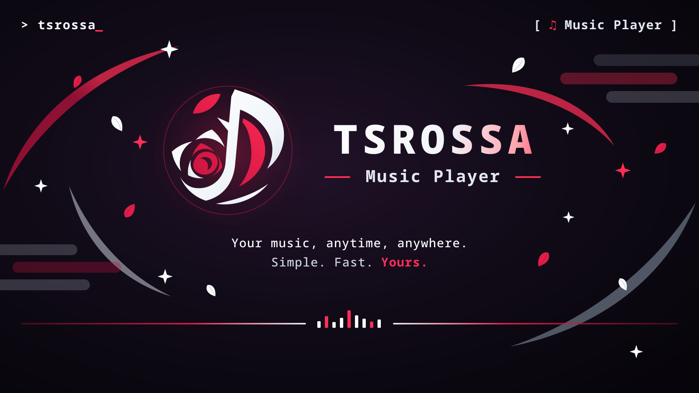
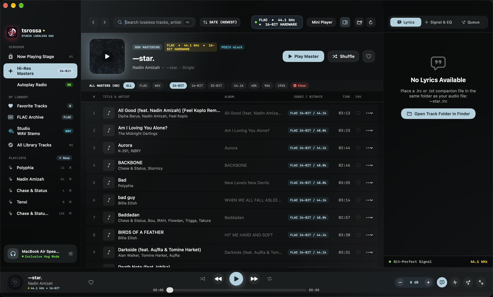
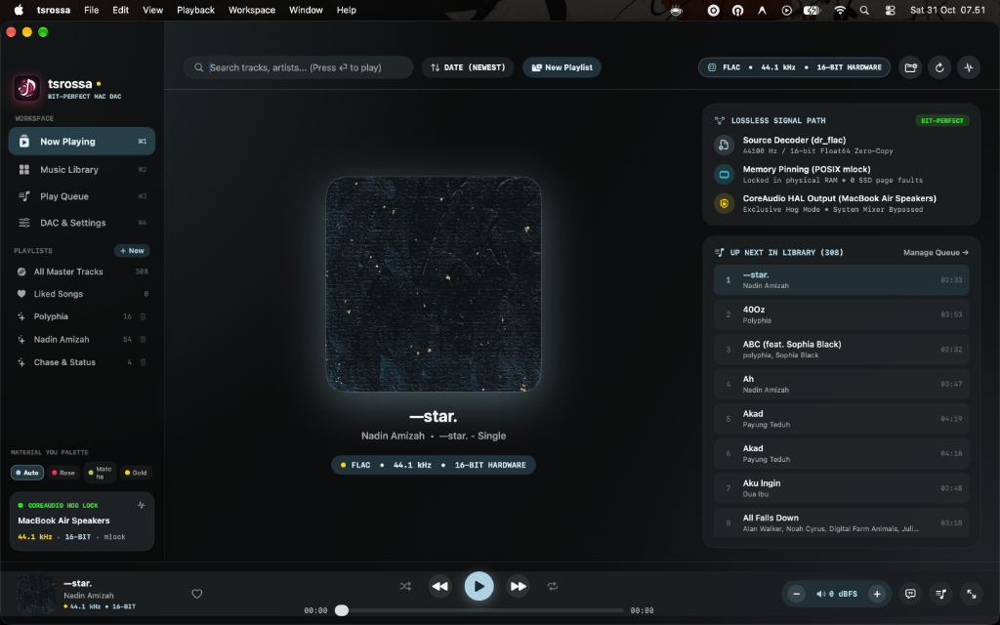
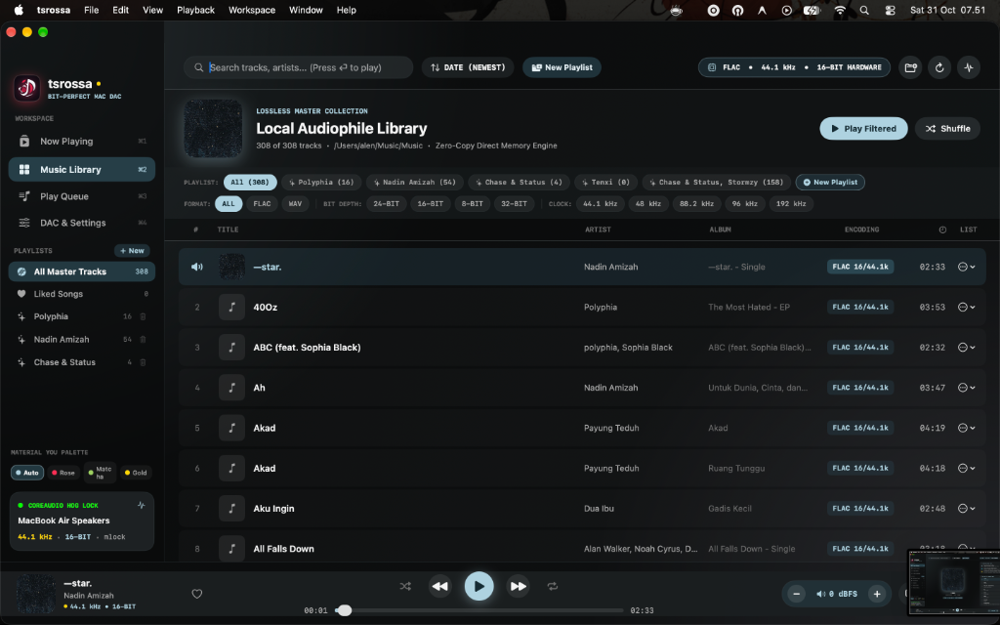
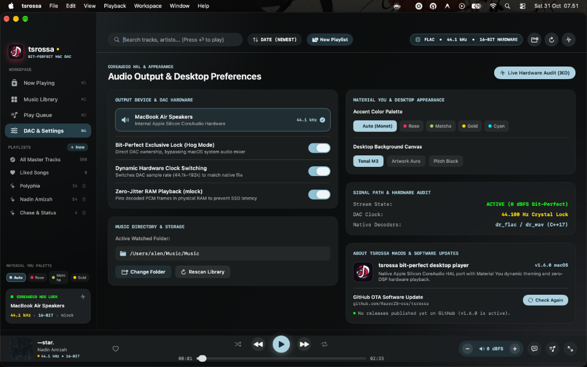

<p align="center">
  
</p>

<h1 align="center">tsrossa for macOS</h1>

<p align="center">
  <strong>Direct-to-DAC Bit-Perfect Audiophile Player for Apple Silicon & Intel</strong><br/>
  High-fidelity C++17 CoreAudio HAL engine with Exclusive Hog Mode and dynamic hardware crystal clock switching.
</p>

<p align="center">
  <a href="https://github.com/Sembir-Garage/tsrossa/releases"></a>
  <a href="#"></a>
  <a href="#"></a>
  <a href="#"></a>
  <a href="#"></a>
  <a href="#"></a>
  <a href="../LICENSE"></a>
  <a href="https://bagibagi.co/Yukaatsu"></a>
</p>

---

## Overview

**tsrossa for macOS** is a dedicated bit-perfect music player tailored for high-end desktop DACs, headphone amplifiers, and direct studio monitors on macOS 12.0 (Monterey) through macOS 15+ (Sequoia).

Standard macOS desktop audio passes all audio streams through the system CoreAudio mixer (`AUHAL`). This default layer:
- Multiplexes notification pings, alert beeps, and browser audio into your music.
- Enforces software resamplers that degrade high-resolution audio fidelity.
- Introduces digital volume math and buffer jitter.

tsrossa bypasses macOS software mixing layers entirely:
- **Exclusive Hog Mode (`kAudioDevicePropertyHogMode`)**: Takes exclusive ownership over the target output hardware. Other apps and macOS system alerts are prevented from routing to the DAC.
- **Dynamic Hardware Sample Rate Switching**: Automatically commands the physical DAC clock to toggle between 44.1 kHz, 48 kHz, 88.2 kHz, 96 kHz, 176.4 kHz, 192 kHz, and 384 kHz without software interpolation or conversion.
- **Memory Buffer Pinning (`mlock`)**: Pre-decodes audio files into uncompressed 32-bit linear PCM and locks buffer pages into physical RAM, eliminating flash drive read spikes and OS swap latency.
- **Hardware Direct Volume & True Unity Gain**: Volume attenuation operates directly on DAC hardware via CoreAudio scalar properties. Setting volume to 100% engages bit-transparent 0 dBFS Unity Gain.

---

## Interface

### Studio Stage Interface
<p align="center">
  
  <br/>
  <em>Studio Stage: 3-column responsive workspace featuring live mastering banner, animated equalizer bars, spinning vinyl record player, collapsible right inspector (lyrics, FFT spectrum, queue), and floating mini-player mode.</em>
</p>

### Desktop Navigation & Views
<table align="center">
  <tr>
    <td align="center" width="33%">
      
      <br/><b>Now Playing (Cmd + 1)</b><br/>
      <sub>Split widescreen view with album artwork canvas, live lossless signal path inspector, and queue continuation</sub>
    </td>
    <td align="center" width="33%">
      
      <br/><b>Audiophile Library (Cmd + 2)</b><br/>
      <sub>Track browser with smart playlists, 1-click format/kHz filter bar, and typeahead search</sub>
    </td>
    <td align="center" width="33%">
      
      <br/><b>CoreAudio Settings (Cmd + 4)</b><br/>
      <sub>Exclusive Hog Mode toggle, dynamic hardware sample rate clocking, RAM mlock, and OTA update engine</sub>
    </td>
  </tr>
</table>

---

## Key Features

- **Direct CoreAudio HAL Output & Exclusive Hog Mode**: Takes exclusive lock over physical DAC hardware (`kAudioDevicePropertyHogMode`), bypassing all system audio mixing and alert sounds.
- **Dynamic Hardware Crystal Clocking**: Queries DAC hardware nominal sample rates and switches physical clock crystals (44.1k to 384k) on the fly without software resampling.
- **3-Column Responsive Studio Workspace**:
  - **Left Sidebar**: Quick navigation for Now Playing, Hi-Res Masters (24-bit filter), Autoplay Radio, FLAC/WAV archives, playlists, and active DAC hardware indicator.
  - **Center Stage**: Hero showcase with cover art, mastering metadata, audiophile filter chips (FLAC/WAV/kHz/bit-depth), and multi-column tracklist with animated equalizer bars for the active track.
  - **Collapsible Right Inspector**: 3-tab panel featuring Time-Synced Lyrics (`.lrc` / embedded), live 32-band FFT Spectrum Visualizer & Signal Path Audit, and Up Next Queue. Auto-collapses on narrower screens (< 1060px) to keep the tracklist spacious.
- **Spinning Vinyl Transport Bar**: Realistic vinyl record disc with concentric grooves and center spindle that rotates smoothly during playback.
- **Floating Mini-Player**: 360x480 compact floating card with ambient artwork blur, live synced lyric line preview, mini scrubber, and transport controls.
- **Synchronized Lyrics Engine**: Discovers companion `.lrc` and `.txt` files alongside audio tracks with millisecond timestamp synchronization, plus fallback parser for embedded ID3 and Vorbis lyrics tags.
- **Full-Screen Theater Mode (`Cmd + F`)**: Immersive large-format view designed for high-resolution displays.
- **Zero-Dependency Native C++17 Audio Engine**: Self-contained CoreAudio driver located in `mac/cpp/` with bundled `dr_flac` and `dr_wav` decoders.

---

## Architecture & Directory Layout

```text
mac/
├── cpp/                               # Self-contained native C++17 CoreAudio HAL Engine
│   ├── CoreAudioSink.cpp / .h         # Hardware HAL driver & Exclusive Hog Mode
│   ├── TsrossaAudioBridge.cpp / .h    # C bridge interface for Swift runtime
│   ├── MacAudioCommon.h               # Ring buffer definitions and PCM audio structures
│   ├── MacAudioDecoder.h              # Decoder abstractions
│   ├── dr_flac.h / dr_wav.h           # Bundled FLAC & WAV single-header decoders
│   └── dr_impl.c                      # Single compilation unit for dr libraries
├── macos/
│   ├── Info.plist                     # Application bundle manifest and audio entitlements
│   └── Sources/                       # Modular SwiftUI Frontend
│       ├── main.swift                 # Entry point (@main NSApplication)
│       ├── MainAppView.swift          # Root 3-column layout router with GeometryReader
│       ├── AppViewModel.swift         # Observable application state, queue, and theme
│       ├── AudioEngine.swift          # Swift interface to native CoreAudio HAL bridge
│       ├── LyricsManager.swift        # Synchronized LRC and ID3/Vorbis parser
│       ├── MetadataScanner.swift      # Concurrent lossless metadata and artwork reader
│       ├── Theme.swift                # Monet-inspired Material You tonal palettes
│       ├── UpdateManager.swift        # OTA update engine via GitHub Releases
│       ├── Components/                # Modular reusable UI components
│       │   ├── SidebarView.swift      # Navigation and playlist sidebar
│       │   ├── TopBarView.swift       # Command search, DAC status pill, and view actions
│       │   ├── TransportBarView.swift # Player controls, scrubber, and volume attenuator
│       │   ├── TrackTableRowView.swift# Multi-column track rows with animated EQ bars
│       │   ├── SpinningVinylView.swift# Smooth rotating vinyl record disc
│       │   └── EqualizerBarsView.swift# 3-bar dancing spectrum indicator
│       ├── Views/                     # Full workspace views
│       │   ├── LibraryView.swift      # Hero banner, filter chips, and tracklist
│       │   ├── NowPlayingView.swift   # Large cover showcase and signal path audit
│       │   ├── QueueView.swift        # Up Next queue manager
│       │   ├── LyricsView.swift       # Time-synced karaoke lyrics
│       │   ├── TheaterView.swift      # Immersive full-screen theater mode
│       │   ├── InspectorView.swift    # 3-tab right inspector (lyrics, FFT, queue)
│       │   ├── MiniPlayerView.swift   # Compact floating mini-player card
│       │   └── SettingsView.swift     # CoreAudio hardware preferences
│       └── Modals/
│           ├── PlaylistModals.swift   # New playlist and queue-saving dialogs
│           └── TelemetryModalView.swift # Signal path and DAC diagnostics modal
├── build_mac.sh                       # Build script compiling dylib and packaging tsrossa.app
├── package_dmg.sh                     # Disk image (.dmg) packaging script
└── README.md                          # Dedicated macOS documentation
```

---

## Technical Specifications

| Parameter | Specification |
| :--- | :--- |
| **Supported Formats** | FLAC (16/24/32-bit, 44.1 kHz to 384 kHz)<br/>WAV (16/24/32-bit Linear PCM & 32-bit Float) |
| **Audio Architecture** | Native C++17 CoreAudio HAL Driver + Swift / SwiftUI |
| **Operating System** | macOS 12.0 (Monterey), 13.0 (Ventura), 14.0 (Sonoma), 15+ (Sequoia) |
| **Supported Architectures** | Apple Silicon (`arm64`), Intel (`x86_64`) |
| **Exclusive Hog Mode** | Supported (`kAudioDevicePropertyHogMode`) with automatic fallback |
| **Clock Management** | Dynamic CoreAudio Nominal Sample Rate Switching (Direct Crystal Lock) |
| **Memory Buffer** | POSIX `mlock()` Physical RAM Pinning |
| **Volume Model** | CoreAudio HAL Master Scalar / 0 dBFS Bit-Transparent Unity Gain |
| **Lyrics Support** | Synchronized `.lrc`, companion `.txt`, embedded ID3 and Vorbis tags |
| **Visualizer** | 32-band real-time FFT spectrum analyzer & lossless signal path telemetry |
| **Subproject Docs** | [Root Overview](../README.md) \| [Android Subproject Guide](../android/README.md) |
| **License** | Apache License 2.0 |

---

## Building from Source

No full Xcode IDE installation is required. Everything compiles directly using standard command line tools (`clang++` and `swiftc`).

### Prerequisites
- macOS 12.0 (Monterey) or later (tested up to macOS 15+ Sequoia).
- Apple Silicon (`arm64`) or Intel (`x86_64`).
- Xcode Command Line Tools:
  ```bash
  xcode-select --install
  ```

### Build Commands

```bash
cd mac
chmod +x build_mac.sh package_dmg.sh

# 1. Build and install directly to /Applications/tsrossa.app (recommended for users)
./build_mac.sh --install

# 2. Or build locally in the workspace (for testing without modifying /Applications)
./build_mac.sh

# 3. Create a distributable disk image (.dmg)
./package_dmg.sh
```

> **Note on App Indexing**: The local build writes to `build.noindex/` to ensure LaunchServices, Spotlight, and Raycast only index the official release in `/Applications/tsrossa.app`.

---

## Keyboard Shortcuts

| Shortcut | Action |
| :--- | :--- |
| `Space` | Play / Pause |
| `Cmd + 1` | Switch to Now Playing Screen |
| `Cmd + 2` | Switch to Music Library |
| `Cmd + 4` | Open Settings & CoreAudio Configuration |
| `Cmd + F` | Toggle Full-Screen Theater Mode |
| `Cmd + K` | Focus Global Search Bar |
| `Cmd + N` | Create New Playlist |
| `Cmd + R` | Rescan Music Library |
| `Cmd + D` | Open Hardware Signal Path Telemetry |
| `Cmd + [` / `Cmd + ]` | Previous / Next Track |
| `Cmd + Up` / `Cmd + Down` | Volume Up / Down (Direct Scalar Control) |

---

## Troubleshooting

### LaunchServices Error -54 ("The application cannot be opened")
If macOS quarantine flags locally compiled binaries or downloaded release builds, clear the quarantine extended attribute:
```bash
xattr -cr /Applications/tsrossa.app
codesign --force --deep -s - /Applications/tsrossa.app
```

### Exclusive Hog Mode Conflict
If another audio app or DAW (Logic Pro, Ableton, Tidal) holds exclusive ownership of your DAC, close that application or toggle Hog Mode off in tsrossa settings (`Cmd + 4`).

### Synchronized Lyrics Not Showing
Make sure your `.lrc` file has the same filename as the audio track and resides in the same directory:
- Track: `/Music/Artist - Track.flac`
- Lyrics: `/Music/Artist - Track.lrc`

---

## Support & Contributions

If you find tsrossa useful for your desktop audiophile setup, consider supporting ongoing development:

[](https://bagibagi.co/Yukaatsu)

Contributions, issue reports, and DAC compatibility logs are welcome on [GitHub Issues](https://github.com/Sembir-Garage/tsrossa/issues). Check out [CONTRIBUTING.md](../CONTRIBUTING.md) for contribution guidelines.

---

## License

tsrossa is distributed under the [Apache License 2.0](../LICENSE).
